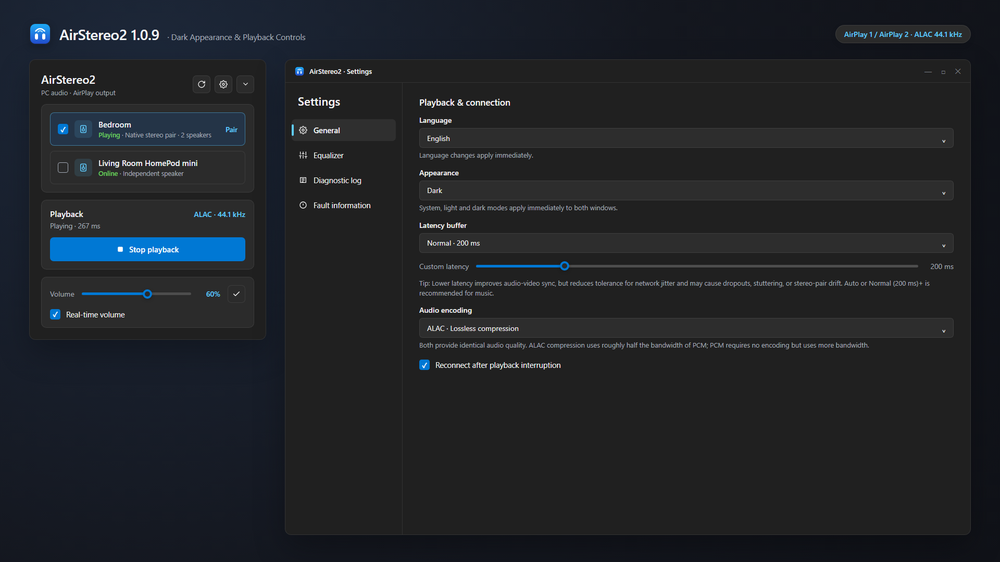
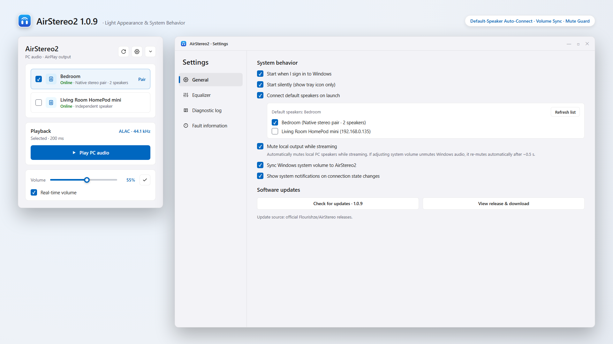
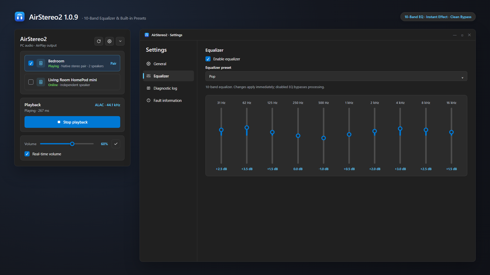
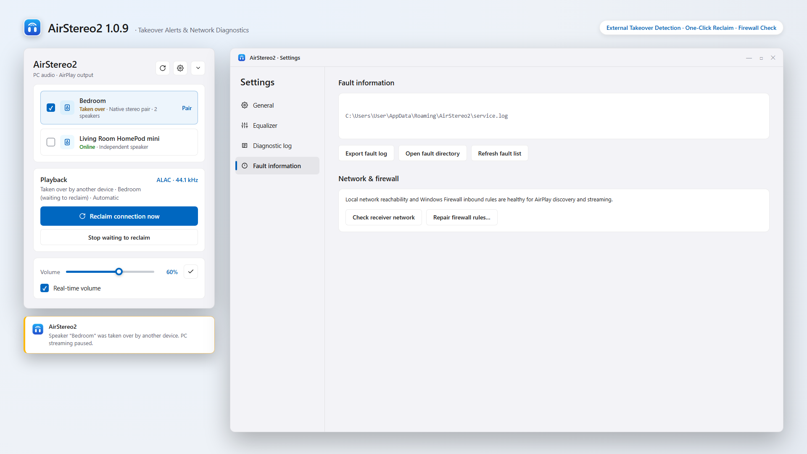

# AirStereo2

[简体中文](README.md) · [Download 1.0.9](https://github.com/Flourishze/AirStereo/releases/tag/v1.0.9)

**Stream audio playing on your Windows PC over your local network to compatible AirPlay / AirPlay 2 speakers.** Current release: **1.0.9** (AirStereo2).

AirStereo2 captures the system mix from your default Windows output device for music, video, games, and everyday applications. Select speakers from the system tray panel and start streaming with no audio file imports and no Bluetooth required.

## Features

| Feature | Description |
| --- | --- |
| AirPlay 1 / AirPlay 2 support | Automatic LAN discovery and manual refresh for AirPlay and AirPlay 2 receivers |
| Single, multi-speaker & stereo pair | Stream full stereo to a single speaker, synchronize multiple speakers, or target native Apple stereo pairs (HomePod / HomePod mini) |
| Manual / live volume control | Drag and click ✓ to apply, or enable live volume adjustment for instant updates |
| System volume sync | Optional automatic sync from Windows keyboard/taskbar volume controls to AirStereo2 |
| Local mute guard | Automatically mutes local PC speakers while streaming; if system volume adjustment unmutes Windows, automatically re-mutes after ~0.5 s and restores the original mute state when stopped |
| Five latency buffer tiers | Choose `Automatic`, `Normal · 200 ms`, `Balanced · 300 ms`, `Stable · 500 ms`, or `Custom (0–1000 ms)` (locked while playing) |
| Lossless & uncompressed audio | `ALAC · Lossless compression` and `PCM · Uncompressed` at AirPlay standard 16-bit / 44.1 kHz |
| Ten-band equalizer | Vertical 10-band EQ in Settings with built-in presets, real-time effect, and clean bypass when disabled |
| External takeover & status alerts | Playback card shows measured latency, codec, and failure details; when an iPhone/iPad takes over a speaker, PC streaming pauses automatically with a tray notification and **Reclaim connection now** / **Stop waiting** actions |
| Automatic reconnection | Automatically recovers receiver connections after temporary interruptions |
| WinUI 3 Fluent interface | Compact tray popup, taskbar theme-adaptive tray icons, System/Light/Dark themes, and high-DPI layouts |
| Chinese / English | Instant bilingual switching with saved preference |
| Tray shortcuts & notifications | Dynamic tray hover status and volume, right-click quick connect / stop playback, and a notification toggle in Settings |
| Startup & default speakers | Windows auto-start, silent tray startup, and a visible speaker checklist in Settings for automatic launch connection |
| Diagnostics, network & firewall | Export diagnostic reports, open log folders, run receiver network checks, and repair Windows Firewall rules directly from Settings |
| GitHub update checker | Checks official releases in this repository reliably across direct and proxy/VPN connections |

## Screenshots

## Installation

- **Standalone MSI Installer**: [AirStereo2-1.0.9-x64.msi](https://github.com/Flourishze/AirStereo/releases/download/v1.0.9/AirStereo2-1.0.9-x64.msi)
  - Simplified Chinese installation wizard with MIT license text and customizable install directory;
  - Detects existing installations for in-place upgrade, remembers the previous install path, and cleanly closes running instances before updating;
  - Includes a **Launch AirStereo2** option on the completion screen.
- **Checksums**: Verify downloads with `SHA256SUMS.txt` attached to the release.

System requirements: Windows 10 22H2 (build 19045) or later on x64, or Windows 11. Runtime and Windows App SDK are bundled; no separate .NET installation is required.

## Usage

1. Connect your PC and speakers to the same local network and ensure local discovery and firewall rules are allowed.
2. Launch AirStereo2, click the tray icon, and wait for speakers to appear (or click Refresh).
3. Check a speaker or native stereo pair and click **Play PC audio**.
4. Adjust volume in the popup, or enable **Sync Windows system volume to AirStereo2** in Settings to use keyboard media volume keys.
5. Stop playback before changing latency buffer or audio encoding (ALAC / PCM).

ALAC and PCM carry identical lossless 16-bit / 44.1 kHz audio samples; ALAC uses roughly half the bandwidth and is recommended for everyday playback.

## Troubleshooting and feedback

If speakers are missing or fail to connect, open **Settings → Fault information → Network & firewall** and run **Check receiver network** / **Repair firewall rules…**. Verify both PC and speakers share the same subnet without router AP isolation.

Report issues via [Issues](https://github.com/Flourishze/AirStereo/issues) with your AirStereo2 version, Windows version, speaker model, and redacted diagnostic logs.

## Documentation and license

[1.0.9 release notes](docs/releases/v1.0.9.md) · [Changelog](CHANGELOG.md) · [MIT License](LICENSE)

Licensed under the [MIT License](LICENSE). AirStereo2 is an independent project and is not affiliated with Apple. AirPlay, HomePod, and other trademarks belong to their respective owners.
