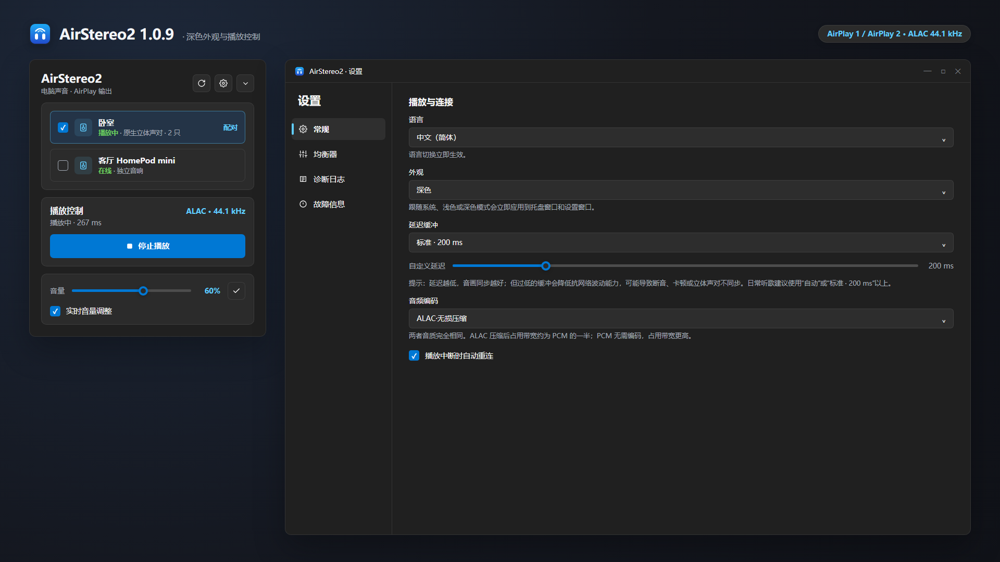
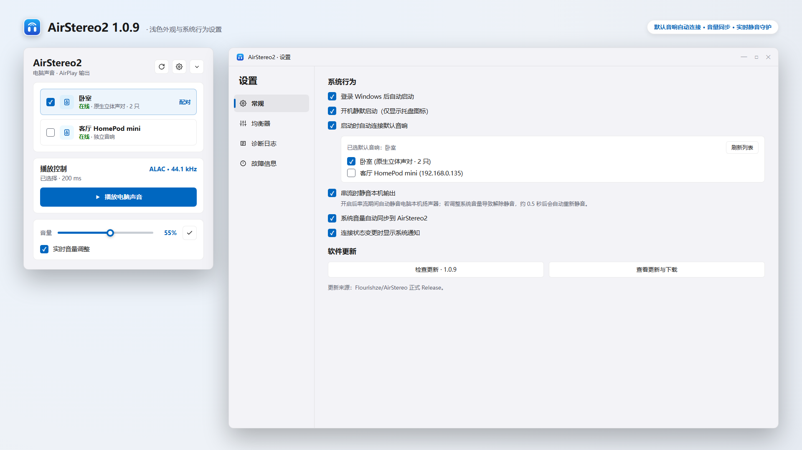
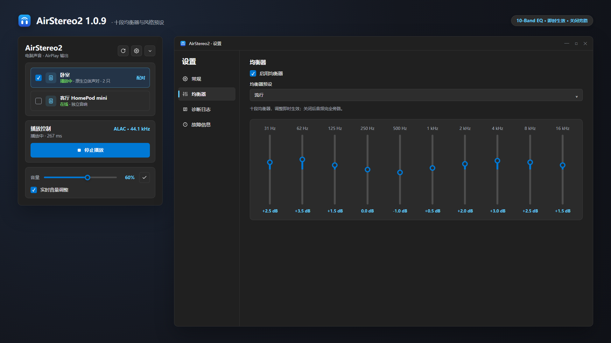
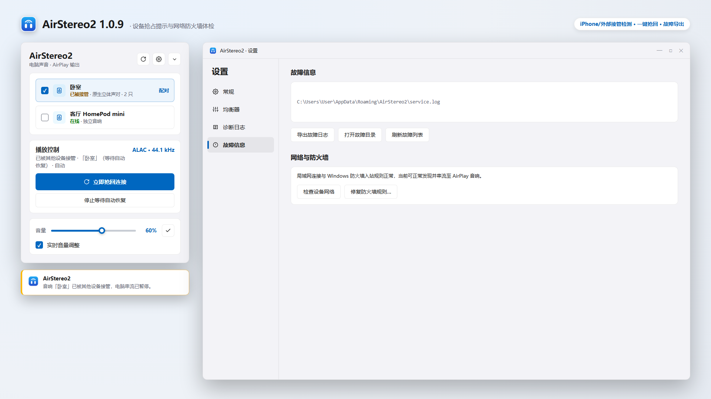

# AirStereo2

[English](README.en.md) · [下载 1.0.9](https://github.com/Flourishze/AirStereo/releases/tag/v1.0.9)

**将 Windows 电脑正在播放的声音，通过局域网无线发送到兼容 AirPlay / AirPlay 2 的音响。** 当前版本：**1.0.9**（AirStereo2）。

AirStereo2 采集系统默认输出设备的混音，适合音乐、视频、游戏与日常应用声音。通过右下角系统托盘选择音响即可开始投送，无需导入音频文件，也不依赖蓝牙。

## 主要功能

| 功能 | 说明 |
| --- | --- |
| AirPlay 1 / AirPlay 2 支持 | 自动扫描与手动刷新局域网内兼容 AirPlay / AirPlay 2 的音响与播放设备 |
| 单设备与多音响同步 | 支持单只音响完整立体声输出、多只音响同步播放，以及 Apple 原生立体声对（如 HomePod / HomePod mini 立体声对） |
| 手动 / 实时音量控制 | 默认拖动后点击右侧 ✓ 应用；开启实时音量调整后拖动即时同步 |
| 系统音量自动同步 | 可选将 Windows 键盘/任务栏系统音量键实时同步到 AirStereo2 |
| 本机静音防抖守护 | 串流期间自动静音电脑扬声器；若调整系统音量导致解除静音，约 0.5 秒后自动重新静音，停止播放后恢复原静音状态 |
| 延迟缓冲五档可调 | 提供 `自动`、`标准 · 200 ms`、`均衡 · 300 ms`、`稳定 · 500 ms`、`自定义（0–1000 ms）`，播放期间锁定，停止后可调 |
| 无损与未压缩编码 | 支持 `ALAC · 无损压缩` 与 `PCM · 未压缩`（AirPlay 标准 16-bit / 44.1 kHz） |
| 十段均衡器 | 设置内集成竖向十段 EQ 与多种风格预设，调整即时生效，关闭后完全旁路 |
| 播放状态与外部抢占提示 | 播放控制卡片展示实测延迟、编码与失败原因；音响被 iPhone / iPad 等其他设备接管时自动暂停电脑串流、推送托盘通知，并提供“立即抢回连接”与“停止等待自动恢复” |
| 播放中断自动重连 | 可开启播放中断后自动恢复连接，减少网络抖动带来的手动重连 |
| WinUI 3 Fluent 界面 | 紧凑托盘弹窗、深浅色自适应托盘图标、系统/浅色/深色主题与高 DPI 布局 |
| 中文 / English | 设置内即时切换并保存软件语言 |
| 托盘快捷控制与免打扰 | 托盘悬停显示实时播放状态与音量；右键支持“快速连接音响”与“停止播放”；设置内可开关系统通知 |
| 启动与默认音响自动连接 | 支持开机自启、开机静默启动；设置页可视化勾选默认音响，启动时自动连接并支持自动重试 |
| 诊断日志与网络/防火墙体检 | 独立日志与故障信息页，支持一键导出故障日志、打开日志目录、检查设备网络连通性及修复 Windows 防火墙规则 |
| GitHub 检查更新 | 内置检查本仓库正式 Release 更新，兼容直连与代理/VPN 网络环境 |

## 截图

## 安装

- **MSI 独立安装版**：[AirStereo2-1.0.9-x64.msi](https://github.com/Flourishze/AirStereo/releases/download/v1.0.9/AirStereo2-1.0.9-x64.msi)
  - 简体中文安装向导，内置 MIT 许可协议说明，支持自定义安装目录；
  - 自动检测本机已安装的旧版本并提示覆盖更新，自动记住上次安装目录并优雅关闭运行中的实例；
  - 安装完成页支持直接勾选“立即启动 AirStereo2”。
- **校验文件**：SHA-256 校验值见 Release 中的 `SHA256SUMS.txt`。

系统要求：Windows 10 22H2（19045）及以上 x64 或 Windows 11。安装包已自包含运行环境与 Windows App SDK，无需另装 .NET。

## 使用

1. 将电脑和音响连接到同一局域网，确保本地网络发现与防火墙规则已放行。
2. 启动 AirStereo2，点击任务栏右下角托盘图标，等待扫描或点击刷新按钮。
3. 勾选要播放的音响或原生立体声对，点击 **“播放电脑声音”** 即可开始无线投送。
4. 通过主面板音量条调节音量，或在设置中开启 **“系统音量自动同步到 AirStereo2”** 直接用键盘音量键控制。
5. 如需调整延迟缓冲或音频编码（ALAC / PCM），请先停止播放再修改。

ALAC 与 PCM 在 16-bit / 44.1 kHz 下保留完全相同的无损音频样本；ALAC 带宽占用约低一半，推荐日常优先使用。

## 常见问题与反馈

扫描不到音响或无法连接时，建议先打开 **设置 → 故障信息 → 网络与防火墙** 点击 **“检查设备网络”** 与 **“修复防火墙规则…”**，并确认电脑与音响在同一子网、未开启路由器 AP 隔离、Windows 网络配置不为受限公用网络。

欢迎通过 [Issues](https://github.com/Flourishze/AirStereo/issues) 反馈问题，提交时可附软件版本、Windows 版本、音响型号及脱敏后的诊断日志（分享前请注意遮盖个人隐私信息）。

## 文档与许可

[1.0.9 更新说明](docs/releases/v1.0.9.md) · [CHANGELOG](CHANGELOG.md) · [MIT 许可证](LICENSE)

项目采用 [MIT 许可证](LICENSE) 开源发布。AirStereo2 是独立项目，与 Apple 无关联；AirPlay、HomePod 等商标均归其各自所有者所有。
